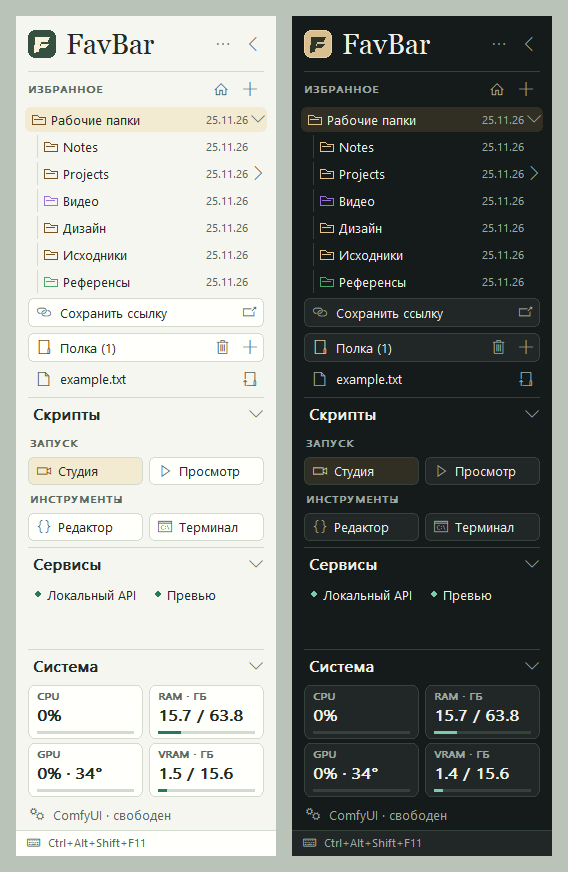

# FavBar

FavBar — компактная боковая панель для Windows 10 и 11. Клик по папке переключает последнее окно Проводника. Рядом находятся файловая полка, кнопки запуска, ссылки на сервисы и показатели системы.

## Запуск

Скачайте **favbar-windows-x64.zip** со [страницы релизов](https://github.com/Hakoba/favbar/releases/latest), распакуйте и откройте **favbar.exe**. На первом запуске панель создаёт профиль в **%LOCALAPPDATA%\FavBar** и добавляет «Документы» в избранное. **Win + Shift + F** скрывает и возвращает панель. Для автозапуска положите ярлык EXE в папку **shell:startup**.

Меню **•••** открывает настройки темы, края экрана, монитора и сортировки. Потяните внутренний край панели для изменения ширины. Выберите «Как в Windows», чтобы следовать системной теме.

## Папки и полка

- Название и значок папки открывают её в Проводнике. Клик по свободному месту строки, дате или стрелке раскрывает и сворачивает ветку. Папка без видимых подпапок открывается по клику в любом месте строки. Средняя кнопка открывает отдельное окно Проводника. Кнопка дома возвращает к домашней папке. Плюс добавляет текущую папку Проводника.
- Правый клик по папке открывает терминал, копирование пути, выбор цвета или собственного изображения. Для избранных папок доступны переименование, изменение порядка и назначение домашней папки.
- Перетащите файл на «Полку» даже в свёрнутом виде. Нажмите имя для открытия, значок справа для показа в Проводнике. С полки файл можно перетащить в другое приложение. Корзина очищает список ссылок. Исходные файлы остаются на диске.
- **F5** пересчитывает даты по последним изменениям файлов в дереве. **F1** открывает справку. Клавиши со стрелками перемещают фокус. **Enter** выбирает действие слева, **Shift + Enter** справа.

## Команды, сервисы и показатели

Откройте **••• → Открыть config.json**. Пример входит в репозиторий и в архив релиза. Панель перечитывает файл при наведении.

| Поле | Назначение |
| --- | --- |
| favorites | Папки с полями name, path и необязательным home |
| buttons | Локальные команды. Поддерживаются name, label, group, icon, cmd, cwd, console, keep и confirm |
| services | Ссылки с полями name, url, label и hidden. Точка показывает доступность TCP-порта |
| hotkey | Глобальная комбинация клавиш, по умолчанию Win+Shift+F |
| skip, hide_dot_folders | Маски имён и видимость папок, начинающихся с точки |
| index_exclude | Абсолютные пути каталогов, пропускаемых при обходе |
| comfy_url, notify_min | Адрес ComfyUI и порог уведомления о завершении длинной очереди в минутах |
| studio_url, studio_projects | Адрес Студии и родительская папка её проектов |
| pocket_db | Файл SQLite для общих закладок Pocket и Hermes |
| legacy_dir | Папка дополнительных локальных провайдеров Strata и температуры CPU |
| lm_url | Адрес сервера LM Studio для списка загруженных моделей |

В шаблонах команд и рабочих каталогов доступны **{explorer}**, **{selected}** и **{selected_name}**. Кнопки выполняют команды с правами текущего пользователя. Используйте конфигурацию из доверенного источника.

Секция «Система» показывает загрузку CPU, оперативную память, загрузку наиболее занятого GPU-движка и резидентную видеопамять выбранного адаптера. При нескольких адаптерах FavBar выбирает устройство с наибольшим объёмом выделенной видеопамяти. Доступность температуры зависит от драйвера. Наведите курсор на GPU для списка процессов или нажмите для просмотра списка в отдельном окне. Правый клик открывает связанные команды освобождения памяти.

## Дополнительные интеграции

**ComfyUI.** Панель показывает состояние очереди, ожидающие задачи и длительность работы. Правый клик открывает режим уведомлений, прерывание текущей задачи и очистку ожидающих с подтверждением. При скрытой панели продолжается только опрос очереди, если включены уведомления.

**Pocket.** Укажите studio_url и pocket_db для сохранения в ту же коллекцию, что используют Pocket и Hermes. Ссылку можно бросить на строку «Сохранить ссылку» или вставить нажатием из буфера. Стрелка открывает коллекцию. Запись в SQLite работает при выключенном сервере.

**Strata и Qwen Code.** В профиле с кнопкой strata_qwen и установленным провайдером strata_mode.py доступны выбор модели, вектора, размера контекста, рабочей папки, продолжения чата, навыков и веб-инструментов. Эта интеграция вызывает локальный Python по запросу. Для температуры CPU используется установленный cpu_temperature.ps1 с параметром -Once при нажатии на CPU. Фоновому процессу панели Python и PowerShell не требуются.

## Перенос с Python-версии

Закройте прежнюю панель перед обычным запуском с тем же хоткеем. Для пробного просмотра используйте параметр **--preview** с отдельным профилем. Этот режим открывает окно без регистрации глобального хоткея и резервирования края экрана.

~~~powershell
.\favbar.exe --import "C:\Tools\favbar-python" --profile "$env:LOCALAPPDATA\FavBar-Test"
.\favbar.exe --preview --profile "$env:LOCALAPPDATA\FavBar-Test"
~~~

Импорт копирует config.json и state.json в новый профиль и завершает работу. Сохраняются избранное, группы, полка, пользовательские значки и выбор темы. Для подключения прежней коллекции ссылок добавьте при импорте **--pocket-db** с полным путём к базе.

Если другие приложения обновляют ваш прежний config.json, укажите его полный путь в поле **config_file** файла **native.json** внутри профиля. В native.json также можно задать локальные поля legacy_dir, pocket_db, index_exclude и lm_url. При таком подключении обе версии используют один файл команд, а состояние интерфейса Rust-версии хранится в её профиле.

## Сборка

Нужны Rust stable для x86_64-pc-windows-msvc, Visual Studio C++ Build Tools и Windows SDK. Из корня репозитория выполните

~~~powershell
cargo test --locked
cargo build --release --locked
~~~

Результат находится в **target\release\favbar.exe**. Логика приложения написана на Rust. Слой C++ вызывает Win32, Shell, OLE и GDI для закрепления окна, отрисовки и перетаскивания. Графические ресурсы для собственного 3D-рендера панель не создаёт.

Код FavBar распространяется по [лицензии MIT](LICENSE).
